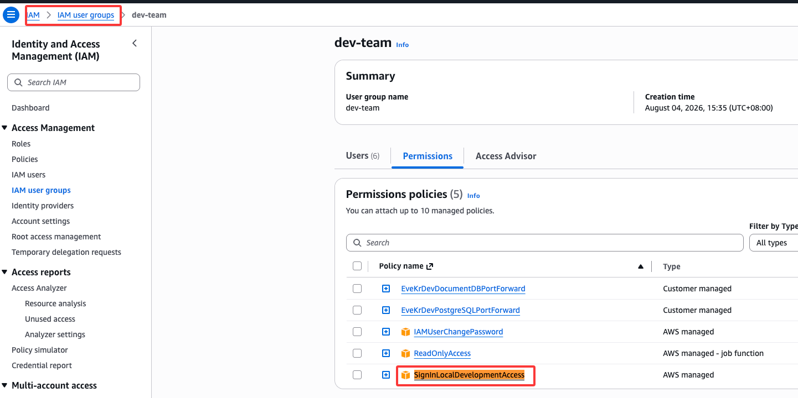

# AWS CLI 登录后，kubectl 和 SSM 为什么都能用了

先说结论：

> `aws login` 不是直接登录 EKS、EC2 或 SSM，而是让本机获得某个 AWS 身份的短期凭证。AWS CLI、`kubectl` 和 SSM 工具随后复用这套凭证访问不同的 AWS 服务。

## 1. 先分清几个概念

| 概念 | 英文全称 | 含义 |
| --- | --- | --- |
| Profile | Profile | 本机的一组 AWS 配置名称，例如 `aws-ns-fangjinxiong` |
| IAM | Identity and Access Management | AWS 的身份与访问管理服务，负责用户、角色和权限策略 |
| IAM User / Role | IAM User / IAM Role | AWS 中真正执行操作的用户或角色身份 |
| ARN | Amazon Resource Name | AWS 身份或资源的全局名称，例如 `arn:aws:iam::346151108217:user/fangjinxiong` |
| SSM | AWS Systems Manager | AWS 的实例运维管理服务；Session Manager 是其中负责远程会话和端口转发的能力 |
| 浏览器 Cookie | HTTP Cookie | 证明浏览器已经登录 AWS Console |
| OAuth 2.0 | OAuth 2.0 Authorization Framework | 浏览器授权 AWS CLI 获取短期凭证所使用的授权框架 |
| PKCE | Proof Key for Code Exchange | 将授权码绑定到发起登录的 CLI，降低授权码被截获后冒用的风险 |
| 临时凭证 | Temporary Security Credentials | `AccessKeyId + SecretAccessKey + SessionToken`，用于签名 AWS API 请求 |
| Refresh Token | Refresh Token | 临时凭证过期后，用来获取下一组临时凭证 |
| IAM Policy | IAM Policy | AWS 服务端保存的权限规则，决定身份能做什么 |
| SigV4 | AWS Signature Version 4 | AWS CLI 使用临时凭证对 API 请求进行签名的算法 |

可以简单记成：

```text
ARN              = 我是谁
本地临时凭证     = 我如何证明并代表这个身份
IAM Policy       = 我被允许做什么
```

## 2. `aws login` 做了什么

本机执行：

```bash
aws login --profile aws-ns-fangjinxiong
```

登录流程如下：

```text
AWS CLI 打开浏览器授权页面
        ↓
浏览器使用 AWS Console Cookie 识别当前用户
        ↓
用户选择或确认 IAM 身份
        ↓
浏览器向本机 localhost 回传一次性 Authorization Code
        ↓
AWS CLI 使用 Authorization Code + PKCE 换取短期凭证
        ↓
短期凭证和 Refresh Token 写入本地缓存
```

AWS Console Cookie 不会交给 AWS CLI。浏览器只把一次性授权结果回调给 CLI；密码、MFA 和 Console Cookie 仍留在浏览器一侧。



### `~/.aws/config`

这个文件保存 Profile 到 AWS 身份的映射，以及 Region 等普通配置：

```ini
[profile aws-ns-fangjinxiong]
login_session = arn:aws:iam::346151108217:user/fangjinxiong
region = us-east-1
```

这段配置只表示：

```text
本地 Profile aws-ns-fangjinxiong
→ 使用 IAM 用户 fangjinxiong
```

ARN 不是凭证，也不包含该用户的权限列表。

### `~/.aws/login/cache/*.json`

这个目录保存真正敏感的登录会话材料，主要包括：

```text
AccessKeyId
SecretAccessKey
SessionToken
RefreshToken
过期时间
ID Token
DPoP Key
```

文件名由 `login_session` 计算得到。同一个 IAM 身份如果被多个 Profile 引用，它们可能共用同一份缓存。

这个 JSON 不是普通的“登录记录”，而是有效期内可以代表该身份访问 AWS 的凭证，不能提交到 Git 或发送给别人。默认文件权限应限制为仅当前用户可读写。

不要把它和 `~/.aws/cli/cache` 混淆。`aws login` 的主要登录缓存位于 `~/.aws/login/cache`。`aws login` 也不会把长期 AccessKey 写入 `~/.aws/credentials`。

### 缓存什么时候更新

| 时机 | 发生的事情 |
| --- | --- |
| 执行 `aws login` | 获取新的短期凭证和 Refresh Token，创建或覆盖缓存 JSON |
| 执行普通 AWS 命令，当前凭证仍有效 | 直接复用缓存，通常不会更新 JSON |
| 临时凭证即将或已经过期，Refresh Token 仍有效 | CLI 或受支持的 SDK 按需刷新凭证，并更新 JSON |
| 整体登录会话过期 | Refresh Token 无法继续刷新，需要重新执行 `aws login` |
| 执行 `aws logout --profile ...` | 删除对应的登录缓存 |

AWS `login` 临时凭证每次最长约 15 分钟，但 CLI 和受支持的 SDK 会按需自动刷新；整个登录会话最长由 IAM 身份的会话时长决定，上限为 12 小时。因此不是每执行一条命令都打开浏览器，也不是每条命令都会改写 JSON。

## 3. 为什么 AWS CLI 后续可以做很多事

执行 AWS 命令时：

```text
aws 命令
→ 根据 --profile 查找配置
→ 从登录缓存取得或刷新临时凭证
→ 使用 SigV4 签名 API 请求
→ AWS 根据 IAM Policy 判断是否允许
```

可以用下面的命令确认当前实际身份：

```bash
aws sts get-caller-identity --profile aws-ns-fangjinxiong
```

登录成功只代表“能够获得该身份的凭证”，不代表拥有所有权限。最终能否调用 EKS、SSM、S3 等服务，仍由服务端 IAM Policy 决定。

## 4. 为什么 `kubectl` 可以管理 AWS EKS

当前 EKS Context 是：

```text
Context:   ns-aws-eve-dev-kr
Cluster:   ns-aws-kr-dev-k8s
Region:    ap-northeast-2
Namespace: eve-kr-dev
Profile:   aws-ns-fangjinxiong
```

`~/.kube/config` 没有长期保存一个 EKS Token，而是配置了动态执行器：

```yaml
exec:
  command: aws
  args:
    - --region
    - ap-northeast-2
    - eks
    - get-token
    - --cluster-name
    - ns-aws-kr-dev-k8s
  env:
    - name: AWS_PROFILE
      value: aws-ns-fangjinxiong
```

每次需要认证时，流程是：

```text
kubectl
→ 执行 aws eks get-token
→ AWS CLI 读取 aws-ns-fangjinxiong 的临时凭证
→ 生成 EKS 身份 Token
→ EKS 识别对应的 IAM 用户或角色
→ EKS Access Entry / Kubernetes RBAC 判断具体权限
```

所以 `kubectl` 并没有独立登录 AWS，它只是调用了已经登录的 AWS CLI。Profile 名只存在于本机，EKS 最终识别的是 IAM 身份。

## 5. 为什么本地可以使用 SSM

本机脚本使用相同的 Profile 建立 SSM 端口转发：

```bash
aws ssm start-session \
  --target i-0c3356bad639f0a25 \
  --document-name EveKrDevPostgreSQLPortForward \
  --parameters "localPortNumber=15432" \
  --region ap-northeast-2 \
  --profile aws-ns-fangjinxiong
```

它的工作流程是：

```text
本机 AWS CLI
→ 使用同一份临时凭证请求 ssm:StartSession
→ IAM 检查身份是否能访问目标实例和 Session Document
→ 本机 Session Manager Plugin 建立数据通道
→ 目标实例上的 SSM Agent 接收并转发流量
→ 本地端口连接到 AWS 内部目标服务
```

当前脚本建立四个本地入口：

```text
PostgreSQL: localhost:15432
Atlas:      本地 1024、1025、1026
```

这里需要区分两层权限：

1. AWS IAM 和 SSM 决定能否建立隧道。
2. PostgreSQL 或 MongoDB 自己的账号密码决定能否登录数据库。

SSM 隧道只解决网络连接，不会自动获得数据库权限。脚本产生的运行日志位于 `/tmp/eve-kr-dev-ssm-${UID}`，这些日志也不是 AWS 登录凭证缓存。

ssm配置document:
https://ap-northeast-2.console.aws.amazon.com/systems-manager/documents?region=ap-northeast-2

## 6. 总结

```text
aws login
→ 本机获得并缓存 IAM 身份的短期凭证
→ AWS CLI 可以使用凭证调用被授权的 AWS API
→ kubectl 通过 aws eks get-token 复用凭证管理 EKS
→ SSM 通过同一凭证建立到目标实例的安全通道
```

核心不是“登录一次后获得所有权限”，而是：

> 登录一次后，本机在有限时间内可以持续证明同一个 AWS 身份；每个 AWS 服务仍会独立检查该身份是否具有相应权限。

## 参考资料

- [AWS CLI：使用 Console 凭证登录](https://docs.aws.amazon.com/cli/latest/userguide/cli-configure-sign-in.html)
- [AWS Login credentials provider](https://docs.aws.amazon.com/sdkref/latest/guide/feature-login-credentials.html)
- [Amazon EKS：配置 kubectl](https://docs.aws.amazon.com/eks/latest/userguide/create-kubeconfig.html)
- [AWS Systems Manager：启动 Session 和端口转发](https://docs.aws.amazon.com/systems-manager/latest/userguide/session-manager-working-with-sessions-start.html)
